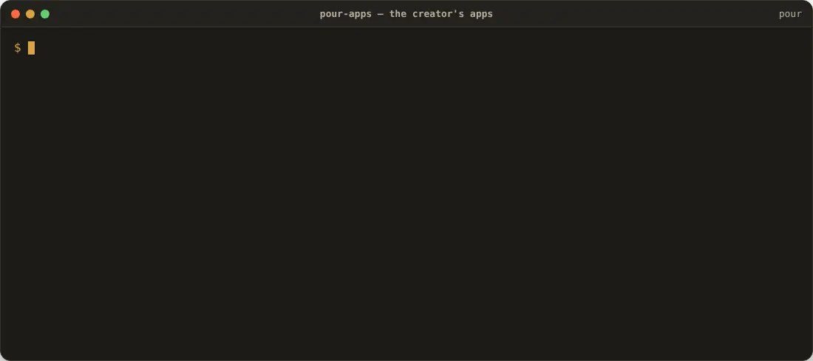
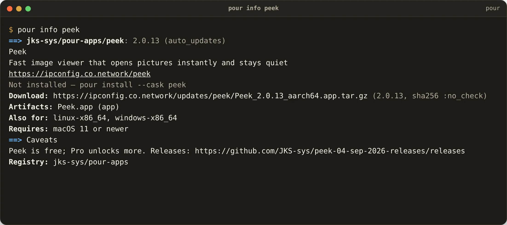
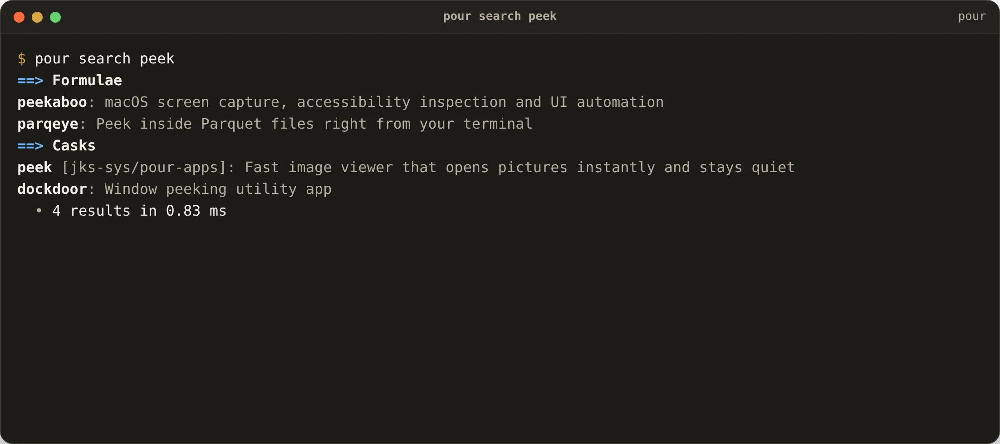

<p align="center">
  <picture>
    <source media="(prefers-color-scheme: dark)" srcset="docs/pour-dark.svg">
    
  </picture>
</p>

<h1 align="center">pour-apps</h1>

<p align="center"><strong>Jagadeesh Kumar S's apps, registered for <a href="https://github.com/JKS-sys/pour-13-Oct-2026">Pour</a>.</strong><br>
macOS · Windows · Linux · ChromeOS · FreeBSD — always the version the app's own release feed says.</p>

```sh
pour install peek voxo nib keel swep grab dial mend twig cine veil
```

> ⭐ **If Pour saves you time, star this repository** — stars are how other people find it.

<!-- apps:start -->
| App | What it is | macOS | Windows | Linux | FreeBSD |
|---|---|:-:|:-:|:-:|:-:|
| **Peek** | Fast image viewer that opens pictures instantly and stays quiet | ✓ | ✓ | ✓ | |
| **Voxo** | Local AI transcription: audio and video into subtitles on your own computer | ✓ | ✓ | ✓ | |
| **Nib** | AI code text editor that opens instantly and never loses work | ✓ | | | |
| **Keel** | AI terminal that marks which commands worked and which failed | ✓ | ✓ | ✓ | |
| **Swep** | AI disk cleaner that shows you everything before it removes it | ✓ | | | |
| **Grab** | Save video, audio and subtitles, then search what was said | ✓ | ✓ | ✓ | |
| **Dial** | AI sound mixer with a volume and an equaliser for every app | ✓ | | ✓ | ✓ |
| **Mend** | AI repair kit for iPhone, Android, your computer and every disk | ✓ | ✓ | ✓ | |
| **Twig** | AI Git client that writes your commit messages for you | ✓ | ✓ | ✓ | |
| **Cine** | Tiny media player that plays anything, with subtitles, AI and Skip Intro | ✓ | | | |
| **Veil** | Private browser where every profile is its own separate device | ✓ | ✓ | ✓ | |
| Hone · Volt · Deft · CutFlow | registered, not released yet — `pour info hone` tells you where to watch | | | | |
<!-- apps:end -->

Product pages, screenshots and Pro plans: [ipconfig.co.network](https://ipconfig.co.network).

## See it move



[▶ Watch with sound (MP4)](docs/demo-apps.mp4)

<table>
<tr>
<td><br><sub>`pour info peek` — the app's description, download for this machine, the other systems it ships for, and how to remove it.</sub></td>
<td><br><sub>The apps show up in `pour search` next to Homebrew's casks, tagged with their registry.</sub></td>
</tr>
</table>

## How it works

- [`apps.json`](apps.json) is the source of truth: token, name, description, homepage, the release feed (`latest.json`), the GitHub releases page, the `.app` name.
- [`build.mjs`](build.mjs) asks every feed for the newest build and writes [`index.json`](index.json) in the shape of Homebrew's cask API, plus a `pour` block with installers for Windows, Linux and FreeBSD and the feed URL.
- Pour ships this registry as a default tap (`jks-sys/pour-apps`). `pour update` fetches `index.json` from [`ipconfig.co.network/pour/apps/index.json`](https://ipconfig.co.network/pour/apps/index.json) (mirror: this repository).
- **Before every install Pour re-reads the app's live feed**, so even a stale `index.json` installs the newest version. The feed also carries the SHA-256 where the app publishes one.
- On macOS the quarantine mark is cleared after placing the app (`pour.clear_quarantine`), because these apps are signed with the creator's own identity rather than notarised with Apple — the same step the creator's Homebrew tap performs.
- [`.github/workflows/sync.yml`](.github/workflows/sync.yml) refreshes `index.json` every six hours and pushes it to R2.

Anyone can publish a registry in this shape: `pour tap add you/apps https://…/index.json`.

<!-- licence -->
## Licence

Copyright © 2026 **Jagadeesh Kumar S**. All rights reserved. The registry and its scripts are source-available under the [Pour licence](https://github.com/JKS-sys/pour-13-Oct-2026/blob/main/LICENSE). The apps themselves have their own terms on their product pages.
<!-- /licence -->
